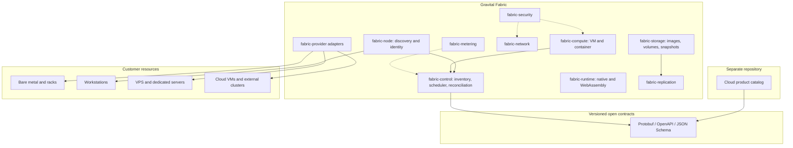

# Fabric layered architecture

> Last reviewed: 2026-11-21. Master chapter: Architecture, section 2.

The control plane is not hosted inside any single provider. A node keeps
running assigned workloads when the link to `fabric-control` is lost.
