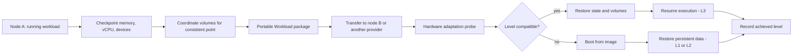

# Portable Workload migration flow

> Last reviewed: 2026-11-21. Master chapter: Architecture, section 5.

L3 is recorded only when the compatibility contract matches. Otherwise the
platform performs a documented downgrade and reports it to the caller.
